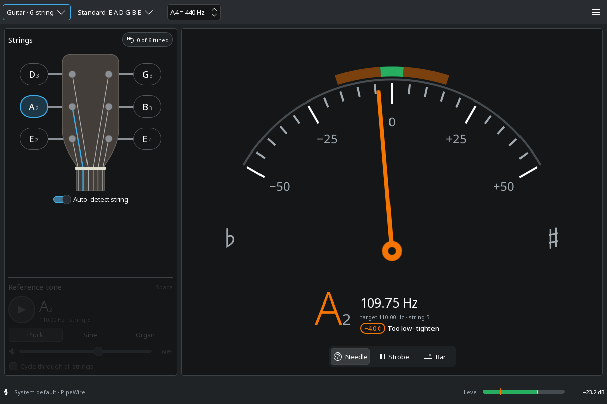
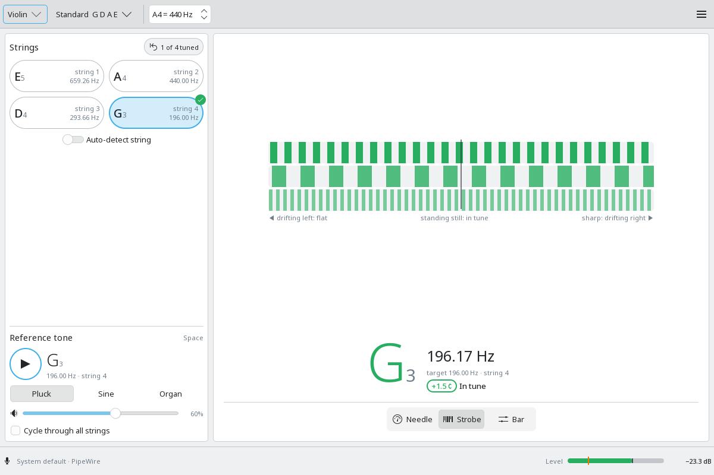

<div align="center">


# Kamerton

**A precise, good-looking instrument tuner for KDE Plasma.**<br>
Listens through your microphone, or plays a reference tone to tune by ear.

[](LICENSE)




</div>

*Kamerton* (камертон) is the Ukrainian word for a tuning fork.

## Features

- 🎸 **Many instruments**: guitar (6 and 7 strings), bass (4 and 5), ukulele, mandolin, banjo, violin, viola, cello, double bass, and a chromatic mode for anything else.
- 🎯 **Accurate**: the YIN pitch detector is typically within ±0.5 cent, including on low strings.
- 🧭 **Three displays**: a needle, a strobe and an LED bar. Switch between them at any time.
- 🤖 **Auto-detect string**: just play. Kamerton works out which string you're tuning and marks each one ✓ once it's in tune.
- 🔊 **Reference tones**: plucked, sine or organ sound for tuning by ear when a microphone can't be used.
- 🎚️ **Input level meter** in dB, with peak hold and the noise gate marked on it.
- 🛠️ **Your own tunings**, adjustable concert pitch (A4) and in-tune tolerance.
- 🎨 **Native look**: built with Kirigami, follows your Plasma color scheme, light or dark.

<p align="center">
  
</p>

## Installation

Ready-made packages (Flatpak, deb, rpm) are planned. For now, Kamerton is built from source. That takes about a minute.

### Dependencies

| Component | Version | Gentoo package |
| --- | --- | --- |
| CMake, Ninja and a C++20 compiler | CMake 3.22+ | `dev-build/cmake`, `dev-build/ninja` |
| Extra CMake Modules | 6.8+ | `kde-frameworks/extra-cmake-modules` |
| Qt: Core, Gui, Qml, Quick, QuickControls2, Widgets | 6.7+ | `dev-qt/qtbase`, `dev-qt/qtdeclarative` |
| KDE Frameworks: Kirigami, CoreAddons, Config, I18n, IconThemes | 6.8+ | `kde-frameworks/kirigami`, `kcoreaddons`, `kconfig`, `ki18n`, `kiconthemes` |
| Kirigami Addons and qqc2-desktop-style (needed at run time) | | `dev-libs/kirigami-addons`, `kde-frameworks/qqc2-desktop-style` |
| PipeWire | 0.3+ | `media-video/pipewire` |
| FFTW 3, single precision | | `sci-libs/fftw` |

A Plasma 6 desktop already has almost all of these. On other distributions, install the development packages with similar names (`-dev` or `-devel`).

### Build and run

```sh
git clone https://github.com/bewzaalex/kamerton.git
cd kamerton
cmake -B build -G Ninja -DCMAKE_BUILD_TYPE=Release
cmake --build build
./build/bin/kamerton
```

Running from `build/` changes nothing outside that folder. To get Kamerton in the application launcher, install it into your home directory:

```sh
cmake -B build -DCMAKE_INSTALL_PREFIX=$HOME/.local
cmake --build build && cmake --install build
```

To uninstall, remove the files listed in `build/install_manifest.txt`.

## How to tune

1. **Choose the instrument and tuning** in the toolbar. Leave **A4** at 440 Hz unless the people you play with tune differently.
2. **Play one string** and let it ring. The big note shows what Kamerton hears, with its octave, e.g. E2.
3. **Turn the peg** until the needle sits in the green center.
   - Left of center means *flat* (too low): tighten the string.
   - Right of center means *sharp* (too high): loosen it.
4. A string that stays in tune gets a ✓ on the headstock. The **x of N tuned** button counts them; click it to start over.

With **Auto-detect string** on, Kamerton follows whatever string you play. Turn it off to stay on one string, then click a string on the headstock to choose it. This helps when a string is far out of tune: after fitting new strings or switching to Drop D.

### Tuning by ear

When you can't use the microphone, for example in a noisy room, turn **Auto-detect string** off. The **Reference tone** panel then becomes available:

- Choose a string, then click **▶** or press <kbd>Space</kbd> to hear its note. Choosing another string switches the tone.
- **Pluck**, **Sine** or **Organ** sets the sound.
- **Cycle** plays the strings one after another.
- In chromatic mode, the semitone buttons choose any note.

### Reading the displays

| Display | How to read it |
| --- | --- |
| **Needle** | A classic meter from −50 to +50 cents. The green zone is your in-tune tolerance. |
| **Strobe** | The bands drift left when the note is flat and right when it's sharp, and stand still when it's exactly in tune. Best for the smallest differences. |
| **LED bar** | A row of lights from flat to sharp. The easiest to read from a distance. |

The **level meter** at the bottom shows the input in dB:
- Green is a healthy level, yellow is loud, red is close to clipping.
- The small marker is the **noise gate**: anything quieter is ignored. If the tuner doesn't react while you play, the level probably doesn't reach that marker.

## Configuration

Open **Configure Kamerton** from the ☰ menu or with <kbd>Ctrl</kbd>+<kbd>Shift</kbd>+<kbd>,</kbd>.

| Setting | Default | What it does |
| --- | --- | --- |
| Microphone / input | System default | The input to listen to: a built-in mic, a USB audio interface, a webcam mic or any other PipeWire source. |
| Speakers / output | System default | Where reference tones play. |
| Noise gate | −55 dB | Sounds quieter than this are ignored. Lower it for a quiet instrument or a distant mic; raise it in a noisy room. |
| Concert pitch (A4) | 440 Hz | 400–480 Hz. Some orchestras use 442 Hz, baroque music 415 Hz. Also in the toolbar. |
| In-tune tolerance | ±3 cents | How close a string must be to count as tuned: ±1–2 cents for recording, ±5 for a quick check. |
| Display | Needle | The display to start with. You can also switch it under the tuner. |

### Custom tunings

**Configure Kamerton → Custom tunings** adds your own tunings to any instrument. Give the tuning a name and list its notes from the lowest string to the highest, for example:

```
Open C    C2 G2 C3 G3 C4 E4
```

Every note needs an octave number: E2 is a guitar's low E, and A4 is concert A. Write sharps and flats as `F#3` or `Bb2`. The new tuning appears in that instrument's tuning menu.

<details>
<summary><b>Built-in tunings</b></summary>

| Instrument | Tunings |
| --- | --- |
| Guitar, 6-string | Standard, Drop D, Half-step down, Full-step down, Drop C, DADGAD, Open G, Open D, Open E |
| Guitar, 7-string | Standard, Drop A |
| Bass, 4-string | Standard, Drop D, Half-step down |
| Bass, 5-string | Standard, High C |
| Ukulele | Standard (high G), Low G, D tuning, Baritone |
| Mandolin | Standard |
| Banjo, 5-string | Open G, Double C, Open D |
| Violin, viola, cello | Standard |
| Double bass | Orchestral, Solo |
| Chromatic | Any note |

</details>

### Settings file

All settings, including custom tunings, are stored in `~/.config/kamertonrc`. To reset Kamerton to its defaults, delete that file.

## Keyboard shortcuts

| Key | Action |
| --- | --- |
| <kbd>Space</kbd> | Play or stop the reference tone (when Auto-detect string is off) |
| <kbd>Ctrl</kbd>+<kbd>Shift</kbd>+<kbd>,</kbd> | Settings |
| <kbd>Ctrl</kbd>+<kbd>Q</kbd> | Quit |

## Troubleshooting

<details>
<summary><b>The tuner doesn't react when I play</b></summary>

Watch the level meter while you play.
- **It doesn't move:** Kamerton is listening to the wrong input. Choose the right one under *Microphone / input*, and check that the mic isn't muted in Plasma's audio settings.
- **It moves but stays left of the noise gate marker:** lower the noise gate or move the mic closer.
</details>

<details>
<summary><b>"Could not connect to PipeWire"</b></summary>

Kamerton talks to PipeWire directly. Check that the user services are running with `systemctl --user status pipewire wireplumber`. Without systemd, make sure PipeWire starts with your session.
</details>

<details>
<summary><b>The reading jumps around on low strings</b></summary>

Low strings (bass B0 and E1, cello C2) have strong overtones. Let the string ring, and pluck it softly, closer to the neck. Turning Auto-detect string off and choosing the string also helps.
</details>

<details>
<summary><b>The tuner reacts to the reference tone</b></summary>

The microphone is always on, so it hears the speakers too. That's expected. Use headphones or turn the volume down.
</details>

## Under the hood

Kamerton is written in C++20 and QML.
- **Audio:** goes straight through PipeWire's native API. There is a mono 48 kHz capture stream, plus a playback stream that exists only while a tone plays.
- **Pitch detection:** the [YIN algorithm](http://audition.ens.fr/adc/pdf/2002_JASA_YIN.pdf), with FFTW autocorrelation over 8192-sample windows and parabolic interpolation. A median filter smooths the result.
- **Reference tones:** synthesized additively in PipeWire's real-time thread.

<details>
<summary><b>Source layout</b></summary>

```
src/
  audioengine.*      PipeWire capture/playback streams and device list
  pitchdetector.*    YIN pitch detection with an FFTW autocorrelation
  tonegenerator.*    additive synth for reference tones (real-time thread)
  instruments.*      built-in instruments, tunings and note helpers
  tunercontroller.*  QML singleton tying it all together, settings via KConfig
  qml/               Kirigami UI
data/                desktop entry, AppStream metainfo, app icon
docs/
  TODO.md            roadmap, backlog and open questions
  mockups/           interactive design mockups, open index.html in a browser
  screenshots/
```
</details>

## Roadmap

Coming next:
- Flatpak, deb and rpm packages.
- Adjusting the noise gate by dragging its marker on the level meter.
- A compact always-on-top mini tuner.

See [docs/TODO.md](docs/TODO.md) for everything planned.

## Contributing

Bug reports, ideas and pull requests are welcome. For anything bigger than a small fix, please [open an issue](https://github.com/bewzaalex/kamerton/issues) first.

- Branch from `main` and open a pull request. Pull requests are squash-merged.
- Title pull requests with [Conventional Commits](https://www.conventionalcommits.org/): `feat:`, `fix:`, `docs:`, …
- In bug reports, mention the instrument and display you used, your distribution, and your Qt and KDE Frameworks versions.

## License

Kamerton is free software: you can redistribute it and/or modify it under the terms of the [GNU General Public License v3.0 or later](LICENSE).

© 2026 Alex Bevza
